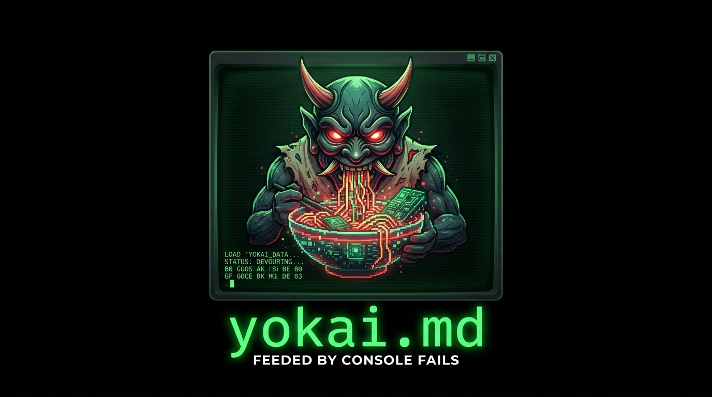

<p align="center"></p>

# yokai

A sarcastic yokai that moves into your project and counts the failed terminal commands of Claude Code's Bash tool. It shows the total in a band above the prompt, spends no tokens (the model never sees the count), and leaves on its own if the project stays quiet (under 20 failures a day) for 7 days in a row.

```
👺 Kage-oni  Console fails: 12 · Yokai HP: 1.5K  [Hide]
```

## Install

In a Claude Code terminal session:

```
/plugin install yokai --marketplace rafafields/yokai.md
```

Answer `y` to add the marketplace, then pick a scope (user scope keeps it in every session). From a shell:

```
claude plugin install yokai --marketplace rafafields/yokai.md
```

In the desktop app, where `/plugin` does not run: click **+** next to the prompt box, then **Plugins**, **Add marketplace** with `rafafields/yokai.md`, then **Add plugin**.

The plugin is a hooks module with a UI (a band above the prompt and a panel), so it needs a Claude Code build that supports mods.

## Use

Run `/yokai summon` in any project. The yokai is per project: its counters live in the plugin's own store, keyed by the project folder.

| Command | What it does |
| --- | --- |
| `/yokai summon` | Births a yokai (random name and emoji, fixed for its life). |
| `/yokai report` | Failures by category, the latest ones with their error text, and a panel. |
| `/yokai rename <name>` | Gives it a new name (40 characters at most). |
| `/yokai export [path]` | Writes the report as JSON. See below. |
| `/yokai lang [code]` | Shows or changes the language. |
| `/yokai show` | Brings the band back after you hide it with its button. |
| `/yokai forget` | Erases the yokai and its counters. |
| `/yokai help` | Lists the commands. |

### What it counts

Every Bash call that ends in an error. Each failure is put in a category (tests, dependencies, syntax, permissions, network, git, filesystem, other) from its error text first and its command second, and the last 100 are kept with the command and the error text (cut at 500 and 1500 characters). Every 10th failure the band shows a sarcastic line for 15 seconds.

A day is quiet when it has fewer than 20 failures; days with no session count as quiet. After 7 quiet days in a row the yokai says goodbye and is deleted. A day with 20 or more failures resets the streak.

### Export

`/yokai export` writes `.claude/yokai/report-<date>T<time>.json` in the project, a new file each time (times are UTC), so exports pile up. `/yokai export some/path.json` writes where you say. The file holds:

```json
{
  "project": "/path/to/project",
  "name": "Kage-oni",
  "emoji": "👺",
  "birth": "2026-11-18",
  "date": "2026-11-18",
  "totalFailures": 42,
  "failuresToday": 12,
  "quietStreak": 0,
  "quietDaysUntilLeaving": 7,
  "topCategory": "tests",
  "categories": [{ "category": "tests", "count": 20 }],
  "incidents": [
    { "at": "2026-11-18T15:31:14.000Z", "category": "dependencies", "command": "npm run x", "error": "…" }
  ],
  "exportedAt": "2026-11-18T16:00:00.000Z"
}
```

Two exports share their most recent failures; to merge them, treat `at` plus `command` as the key.

## Language

The `lang` option sets the language of every text the yokai shows: the band, the panel, the command answers, the category names and the 50 sarcastic phrases. Change it with `/yokai lang es`, from `/config` (the plugin's **Language** row), or in settings under `pluginConfigs.yokai.options.lang`. Default `en`.

- Available: `en`, `es`, `fr`, `de`, `pt`, `ja`, `zh`. A regional code such as `pt-BR` uses `pt`.
- The translations ship with the plugin in `locales/<code>.json`. Choosing a language costs no tokens and makes no model call.
- A code with no file stays in English and a notice lists the available ones.
- To add a language, copy `locales/es.json` to `locales/<code>.json` and translate the values. Keep the keys and the `{placeholders}`. The English text in `hooks/strings.ts` and `hooks/data.ts` fills any key left out, and a line that loses a placeholder is replaced by its English original.
- Slash commands, the word "yokai", yokai names and the JSON export keys are never translated.

## Privacy

Everything stays on your machine. The plugin makes no network or model calls. Counters and the last 100 failures (with their command and error text) are kept in the plugin's own store under your Claude Code configuration folder, and in the files you export. If a failing command prints a secret, it can end up there: delete the yokai with `/yokai forget`, or don't commit `.claude/yokai/`.

## Layout

```
.claude-plugin/plugin.json        manifest and the `lang` option
.claude-plugin/marketplace.json   makes this repository a marketplace
hooks/register.tsx                the hooks, the commands and the UI
hooks/strings.ts                  every text, in English
hooks/data.ts                     error categories, phrases, names and emoji
locales/*.json                    translations
types/index.d.ts                  the types of the state the UI reads
```

## History

This plugin replaces the `yokai.md` protocol (v1 to v9), a self-installing file that used bash hooks and a status line. Its sources remain in this repository's git history.

## License

MIT, see [LICENSE](LICENSE).
